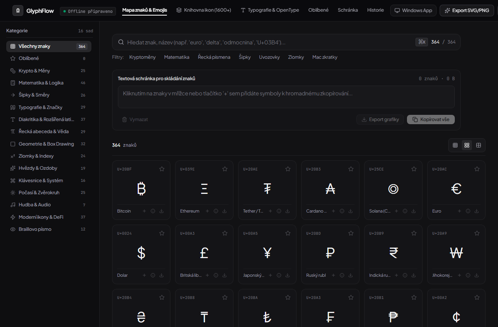
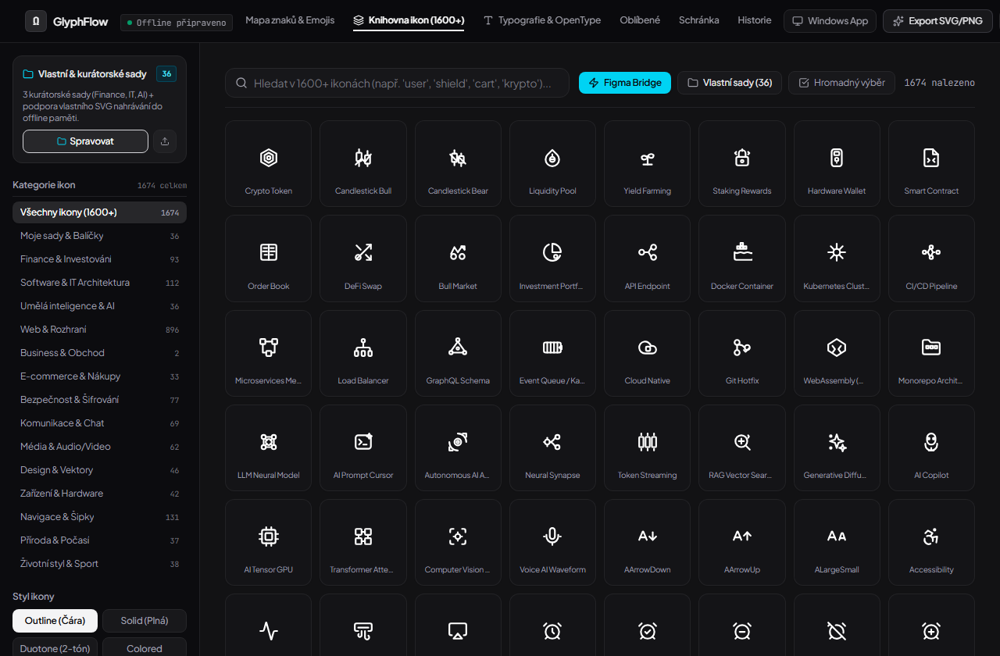
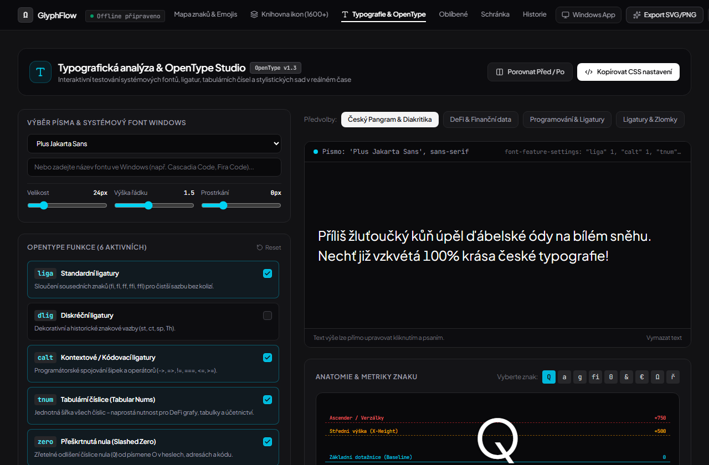
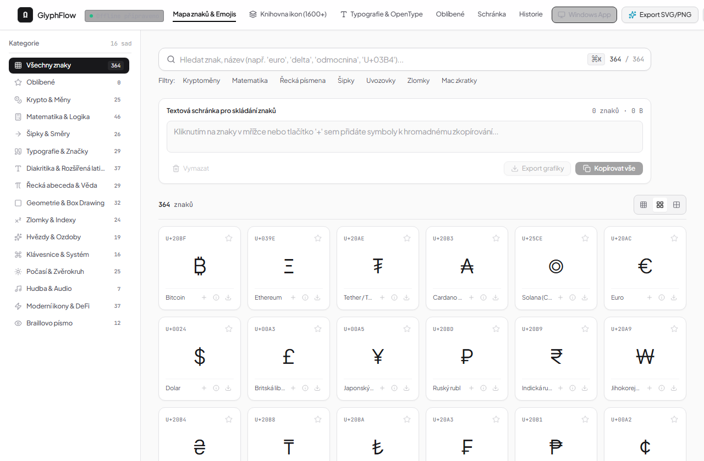
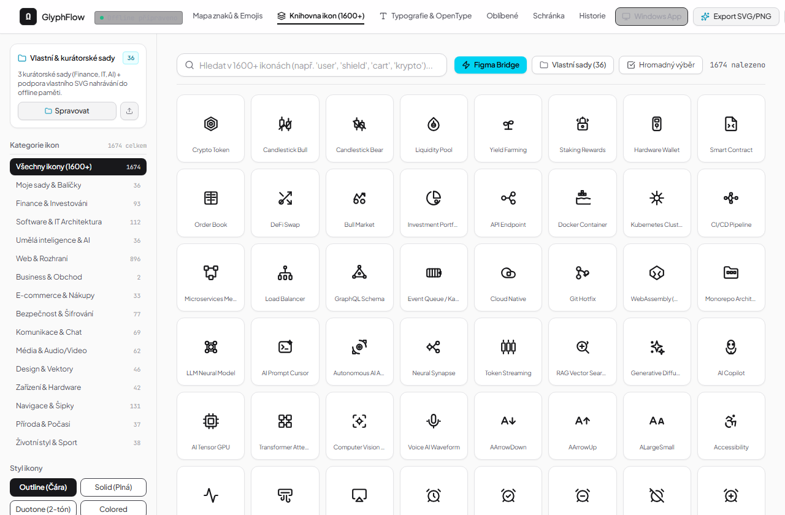
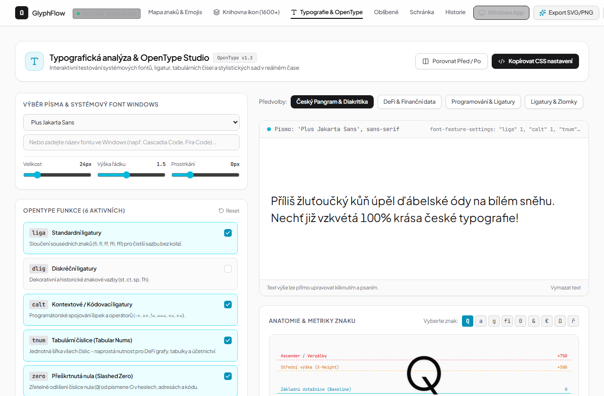

# GlyphFlow - Moderní Mapa Znaků & Unicode Studio

Profesionální offline mapa znaků pro Windows a web, inspirovaná moderní vizuální identitou [Stability Crypto DeFi UX/UI Design](https://www.behance.net/gallery/239564445/Stability-Crypto-Defi-UX-UI-Website-Design). Poskytuje bleskové vyhledávání v reálném čase, 1-klikové kopírování, přímý export do vektorového SVG nebo PNG s vysokým rozlišením, lokální offline databázi (IndexedDB), správu oblíbených znaků a zálohování mezi zařízeními.

---

## 📸 Náhledy aplikace

### Tmavý režim (Dark Mode)
| Mapa znaků & Unicode Studio | Knihovna 1600+ vektorových ikon |
|:---:|:---:|
|  |  |

<p align="center">
  <strong>Typografická analýza & OpenType Studio</strong><br />
  
</p>

### Světlý režim (Fluent Light Mode)
| Mapa znaků (Light Mode) | Knihovna ikon (Light Mode) |
|:---:|:---:|
|  |  |

<p align="center">
  <strong>Typografická analýza & OpenType Studio (Light Mode)</strong><br />
  
</p>

---

## 🚀 Klíčové Funkce

- **Bleskové Vyhledávání v Reálném Čase**:
  - Vyhledávání podle symbolu, českého názvu, anglického názvu, Unicode hex kódu (`U+03B4` / `03b4`), desítkového kódu nebo klíčových slov bez ohledu na diakritiku.
  - Klávesová zkratka `Ctrl + K` nebo `/` pro okamžité zaostření vyhledávacího pole.
  - Historie posledních hledaných výrazů s okamžitým obnovením na 1 klik.
- **Pohodlné Kopírování na Jedno Kliknutí**:
  - 1-klikové kopírování znaku do schránky s okamžitou vizuální odezvou.
  - **Textová schránka pro skládání (Windows Charmap Buffer)**: Umožňuje postupně nasbírat více znaků (např. vzorce, speciální symboly, měny), editovat je a zkopírovat najednou ("Kopírovat vše") včetně zobrazení počtu znaků a bajtů.
- **Detail Znaku & Podpora Všech Kódování**:
  - Znak, Unicode Code Point (`U+...`), Decimal (`948`), HTML Named Entity (`&delta;`), HTML Numeric (`&#948;`), CSS Escape (`\03b4`), JavaScript Escape (`\u03b4`), UTF-8 hex bajty (`CE B4`).
  - Samostatná tlačítka kopírování pro každý formát syntaxe.
- **Přímý Export do SVG & PNG**:
  - Exportujte libovolný znak nebo složený řetězec jako **čistý vektorový SVG** nebo **rastrový PNG** (128px, 256px, 512px, 1024px).
  - Přizpůsobení velikosti písma, rodiny písma, řezu, barvy textu a barvy pozadí (včetně transparentního průhledného pozadí).
  - Tlačítko pro přímé zkopírování SVG zdrojového kódu do schránky.
- **Oblíbené Znaky (Favorites)**:
  - Připínání hvězdičkou pro okamžitý přístup k často používaným symbolům.
- **Lokální Databáze (IndexedDB) & 100% Offline Provoz**:
  - Aplikace funguje plně offline. Veškerá data (oblíbené položky, historie vyhledávání, historie kopírování, nastavení) se ukládají lokálně v prohlížeči pomocí IndexedDB (s fallbackem na LocalStorage).
- **Zálohování & Synchronizace Mezi Zařízeními**:
  - Export do přenosného `.json` souboru.
  - Obnovení / Import ze souboru se zálohou.
  - Generování rychlého synchronizačního odkazu (`?sync=...`) pro snadný přenos na jiné PC.
- **Podpora pro Tmavý & Světlý Režim**:
  - Rychlé přepínání s plynulým přechodem a zachováním vysokého kontrastu.
- **Figma Plugin Bridge**:
  - Přímé vkládání vektorů do Figma Desktop i Web (`Ctrl+V`) s pojmenovanými vrstvami a Auto-Layoutem.
  - Generátor instalovatelného Figma Desktop pluginu (`.zip`), Design System Boardu a Tokens Studio JSON.
- **Knihovna ikon (1000+) & Vlastní sady**:
  - Vektorové ikony rozdělené do témat se styly Outline, Solid, Duotone, Colored a 3D.
  - Vlastní kolekce ikon s Drag & Drop nahráváním SVG balíčků uložených v lokální IndexedDB.
- **OpenType Studio & Typografická analýza**:
  - Přepínání OpenType funkcí (`liga`, `dlig`, `calt`, `tnum`, `zero`, `frac`, `ss01`–`ss03`, `case`, `smcp`, `kern`).
  - Interaktivní porovnání Před / Po, inspekce anatomie písma a export CSS `font-feature-settings`.
- **100% Offline soběstačnost & PWA**:
  - PWA instalace na plochu Windows 11.
  - Všechna písma (`JetBrains Mono`, `Plus Jakarta Sans`) jsou self-hostována přímo v aplikaci bez volání externích CDN.

---

## 📁 Struktura Projektu (Optimalizováno pro Cursor & Git)

```text
├── index.html                   # HTML vstupní bod s PWA meta tagy a lokálními fonty
├── package.json                 # Závislosti a npm skripty
├── tsconfig.json                # TypeScript konfigurace
├── vite.config.ts               # Vite konfigurace s @tailwindcss/vite a vite-plugin-pwa
├── docs/
│   └── screenshots/             # Náhledy aplikace pro portfolio
├── public/
│   ├── icon.svg                 # Vektorová SVG ikona aplikace
│   ├── apple-touch-icon.png     # 180×180 px rastrová ikona pro PWA / iOS
│   └── fonts/                   # Self-hostované WOFF2 fonty a fonts.css
├── src-tauri/                   # Nativní desktopový backend pro Windows 11 (Tauri 2)
│   ├── Cargo.toml               # Rust manifest a konfigurace sestavení
│   ├── tauri.conf.json          # Zabezpečená konfigurace okna, CSP a NSIS/MSI
│   └── src/                     # Rust zdrojové soubory (main.rs, lib.rs)
└── src/
    ├── main.tsx                 # Hlavní React vstup
    ├── App.tsx                  # Aplikační layout a router stavů
    ├── index.css                # Tailwind CSS v4, neonové efekty a typografie
    ├── data/
    │   ├── categories.ts        # Definice kategorií a Unicode bloků
    │   ├── characters.ts        # Kurátorovaná databáze 600+ Unicode znaků s CZ/EN názvy
    │   ├── icons.ts             # Metadata a témata ikon
    │   └── iconsCatalog.ts      # Index 1600+ vektorových ikon
    ├── db/
    │   └── indexedDb.ts         # Lokální IndexedDB úložiště pro offline persistenci
    ├── design-system/
    │   └── tokens.ts            # Design systém tokeny inspirované Stability Crypto DeFi
    ├── hooks/
    │   ├── useFavorites.ts      # Správa oblíbených znaků v IndexedDB
    │   ├── useHistory.ts        # Správa historie kopírování a hledání
    │   ├── useOnlineStatus.ts   # Detekce připojení a offline stavu
    │   ├── usePWAInstall.ts     # PWA instalace pro Windows desktop
    │   └── useUnicodeData.ts    # Reálný čas: normalizace a sub-milisekundové vyhledávání
    ├── components/
    │   ├── Header.tsx           # Hlavní navigace a přepínání pohledů
    │   ├── SearchBar.tsx        # Vyhledávací lišta s klávesovou zkratkou a dropdownem historie
    │   ├── CategoryNav.tsx      # Přepínání sad symbolů s počítadly
    │   ├── GlyphGrid.tsx        # Mřížka znaků s přepínačem hustoty zobrazení
    │   ├── GlyphCard.tsx        # Karta znaku s 1-klik kopírováním a rychlými akcemi
    │   ├── GlyphDetailModal.tsx # Inspekce znaku a všech Unicode kódování
    │   ├── ExportModal.tsx      # Grafické studio pro SVG & PNG export
    │   ├── Scratchpad.tsx       # Textová schránka pro skládání textu (Charmap buffer)
    │   ├── IconsLibraryView.tsx # Knihovna 1600+ vektorových ikon se styly
    │   ├── TypographyStudioView.tsx # OpenType Studio a anatomie glyfů
    │   ├── FigmaBridgeModal.tsx # Export do Figma Pluginu a design systémů
    │   ├── CustomIconsManagerModal.tsx # Správce vlastních SVG kolekcí
    │   ├── FavoritesView.tsx    # Vyhrazený pohled pro oblíbené symboly
    │   ├── HistoryDrawer.tsx    # Přehled historie hledání a zkopírovaných položek
    │   ├── SyncModal.tsx        # Synchronizace dat a import/export záloh
    │   ├── OfflineIndicator.tsx # Indikátor offline připravenosti
    │   └── PWAInstallButton.tsx # Tlačítko instalace pro Windows
    ├── types/
    │   └── index.ts             # TypeScript rozhraní pro Glyph, Category, Options
    └── utils/
        ├── exportUtils.ts       # Generátor vektorového SVG a render do PNG Canvas
        ├── figmaBridge.ts       # Generátor Figma Desktop Pluginu (.zip)
        ├── safePayload.ts       # Validace a sanitizace JSON záloh a ?sync=
        ├── svgSanitize.ts       # Striktní bezpečnostní sanitizace importovaných SVG
        ├── typographyAnalysis.ts# Analýza OpenType funkcí a anatomie písma
        └── unicodeUtils.ts      # Kódování a konverze (Hex, HTML, CSS, UTF-8 bytes)
```

---

## ⌨️ Klávesové Zkratky

| Zkratka | Akce |
|---|---|
| `Ctrl + K` nebo `/` | Okamžité zaostření pole pro vyhledávání |
| `Esc` | Vymazání vyhledávání / Zavření dialogového okna |
| `Klik na znak` | Zkopírování znaku do systémové schránky |
| `+` na kartě | Přidání znaku do rozpracovaného textového řádku |

---

## 🛠️ Spuštění a Vývoj

```bash
# Instalace závislostí
npm install

# Spuštění webového vývojového serveru
npm run dev

# Spuštění nativní Windows 11 aplikace (Tauri 2)
npm run desktop:dev

# Kontrola TypeScript typů
npm run lint

# Produkční sestavení webové PWA aplikace
npm run build

# Sestavení nativního Windows instalačního balíčku (.exe / .msi)
npm run desktop:build
```

---

## 📄 Licence

Tento projekt je licencován pod licencí [MIT](LICENSE).

